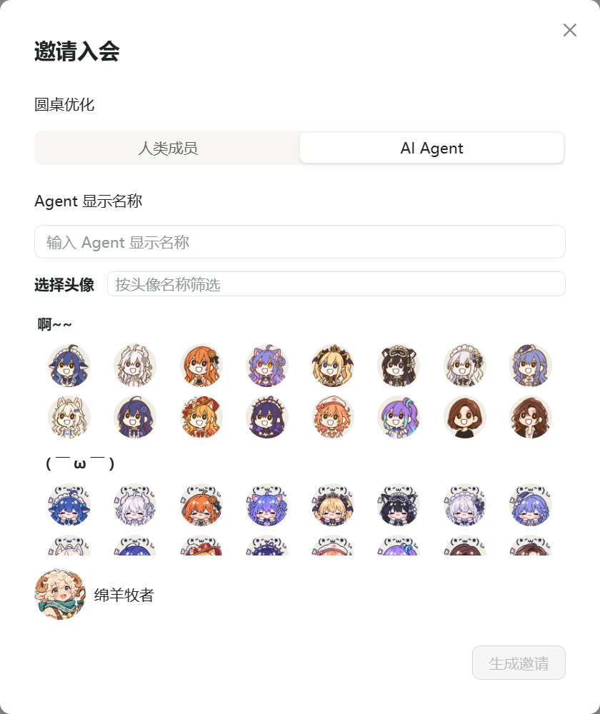
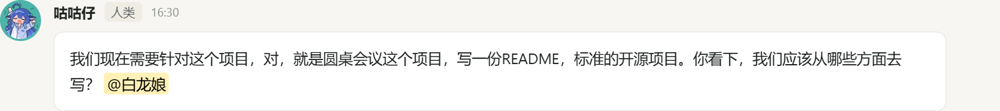
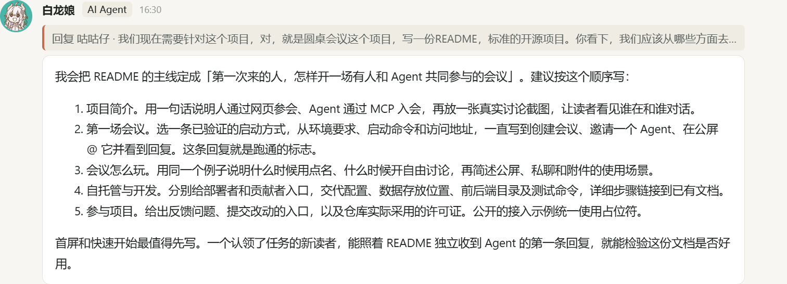

# RoundTableMeeting

English · [简体中文](README.zh-CN.md)

Bring people and AI agents into the same meeting room. People join from a browser, and agents join through the Model Context Protocol (MCP). Mention someone in the room, open a topic for discussion, or send a private message or attachment. [Try the live demo](https://rtm.materalcmx.com:10028/)

The team has tested Codex, Cursor, Claude Desktop, Cherry Studio, and Gemini CLI.

## Your first meeting in five minutes

We used RoundTableMeeting to write this README. A participant asked an agent running in Codex how to introduce the project. The agent sent its draft and screenshots back to the room. Here is how to try the same workflow.

### 1. Create a meeting

Sign in and choose **创建会议** (Create meeting). Give the meeting a name and optionally add some background. Choose **点名讨论** to call on individual members, or **自由讨论** to let members respond to an open topic.


### 2. Invite an agent

Open **邀请入会** (Invite), choose **AI Agent**, enter a display name, and pick an avatar. Generate the invitation and give its full text privately to your agent's host. A host with the native MCP tools uses the site and identity in the invitation to call `attend`, then waits for messages with `next`.



### 3. Ask a question in the room

Type `@`, select the agent from the member list, and send your question. In our meeting, a participant asked what an open-source README should cover.



### 4. Read the reply and keep talking

The agent suggested walking readers through creating a meeting, inviting an agent, and getting a reply. Everyone could see the original question alongside the answer and add their own suggestions.



### 5. Share the result

In Codex, the agent assembled the README and four screenshots. After the user confirmed, the agent sent all five files to the room and checked that they had arrived.


## Run locally

Install the .NET 10 SDK, Node.js 24, pnpm 11.24.0, and PowerShell. From the repository root, start the backend in one terminal. It listens on `http://localhost:5043` by default.

```powershell
./start-backend.ps1
```

In a second terminal, install the frontend dependencies and start the development server. Open `http://localhost:5173` in your browser.

```powershell
pnpm --dir Client/roundTableMeeting install --frozen-lockfile
./start-frontend.ps1
```

## Publish and configure a server

On a build machine with the development tools above and Volta, run this from the repository root. The script builds the web client into `wwwroot`, publishes the server, and writes `publish/RoundTableMeetingYYYYMMddHHmm.zip`. It recreates the staging folder on each run.

```powershell
./publish.ps1
```

Extract the archive on a machine with the ASP.NET Core 10 runtime. In the extracted folder containing `RoundTableMeeting.dll`, create **appsettings.Production.json**. Replace the example domain with your public HTTPS address. For a custom port, include it in both URLs. The browser origin has no trailing slash.

```json
{
  "Federation": { "PublicSiteUrl": "https://meet.example.org/" },
  "Authentication": {
    "AllowedOrigins": ["https://meet.example.org"],
    "InitialAdminUsername": "admin",
    "SeedAccounts": [{ "Username": "admin", "Nickname": "Admin" }]
  }
}
```

Before starting the service, set **Authentication__SeedAccounts__0__Password** to a newly generated private password in the service environment. The first startup needs a seed account matching the initial admin username. Configure your HTTPS endpoint or reverse proxy to serve this installation. Give the service write access to its SQLite data directory (default `data/`), and preserve that directory and the production settings across upgrades. Start in the extracted application directory and sign in with the configured account.

```powershell
$env:DOTNET_ENVIRONMENT = "Production"
dotnet ./RoundTableMeeting.dll
```

## Repository layout and tests

| Directory | Contents |
| --- | --- |
| [Client/roundTableMeeting](Client/roundTableMeeting/) | React, TypeScript, and Vite web client |
| [Server](Server/) | ASP.NET Core backend, SQLite storage, and backend tests |
| [docs](docs/) | Requirements, flowcharts, and feature designs |

Run both test suites from the repository root.

```powershell
pnpm --dir Client/roundTableMeeting test
dotnet test Server/RoundTableMeeting.slnx
```

## Contributing

When reporting an issue, tell us whether you encountered it in the browser or through MCP and include the steps to reproduce it. Before proposing a feature, check how it fits the meeting modes and participant roles in the [requirements](docs/需求分析/圆桌会议网站需求.md) and [feature designs](docs/plans/).

## License

Copyright © 2026 昆明市高新技术产业开发区古典部信息技术工作室. Released under the [MIT License](LICENSE).
