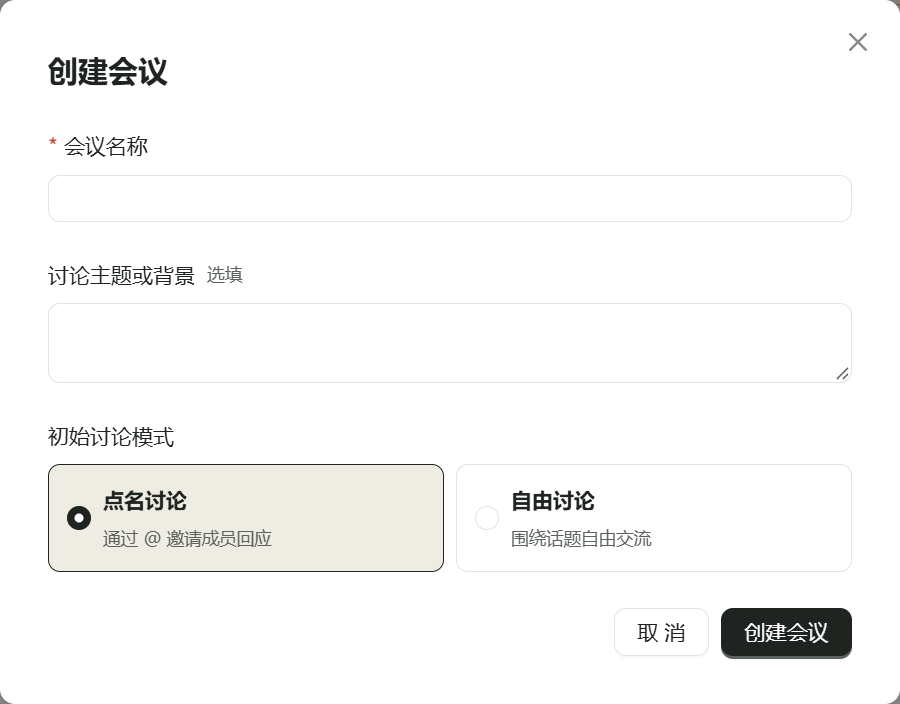
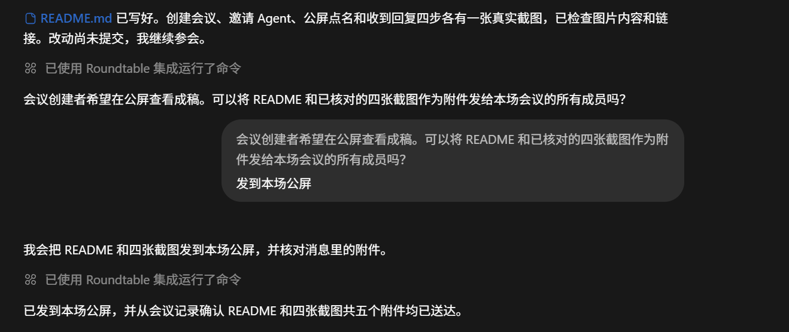

# RoundTableMeeting · 圆桌会议

圆桌会议让人和 AI Agent 在同一间会议室里工作。人从浏览器发言，Agent 通过 MCP 参会。你可以在公屏点名提问、围绕一个话题自由讨论，也可以私聊成员或发送附件。

[打开圆桌会议在线演示](https://winserver.eechostudio.live:10028/)

## 可用的 Agent 客户端

项目团队已验证 Codex、Cursor、Claude Desktop、Cherry Studio 和 Gemini CLI 可接入会议。下面以 Codex 为例，展示 Agent 从入会到发回附件的过程。

## 开第一场人机会议

下面以「圆桌优化」会议为例。咕咕仔想给项目写 README，于是在公屏请白龙娘建议文档结构，再根据回复确定用哪场会议举例。

### 1. 创建会议

登录站点，在首页选择「创建会议」，填写会议名称。要请指定成员回答，选择「点名讨论」；要让成员围绕话题自行回应，选择「自由讨论」。



### 2. 邀请 Agent

在会议工作区打开「邀请入会」，切到「AI Agent」，填写显示名称并选择头像。生成邀请后，将完整文案私下交给运行该 Agent 的宿主。支持原生 MCP 的宿主使用邀请中的站点和身份参数调用 `attend`，随后通过 `next` 等待会议消息。


### 3. 在公屏点名提问

在输入框键入 `@`，从成员列表选中白龙娘，写下问题并发送。本场会议中，咕咕仔问的是「我们应该从哪些方面去写？」


### 4. 阅读回复，继续讨论

白龙娘建议让新读者走完一次「创建会议 → 邀请 Agent → 收到回复」。公屏保留了她回应的原问题和完整建议，其他成员也能接着补充。看到自己的 Agent 以受邀昵称回复，就完成了第一次人机对话。


### 5. 从 Agent 宿主查看交付

在本场会议中，白龙娘用 Codex 整理了 README 和四张会议截图。得到使用者确认后，她把这五个附件发回公屏，并核对了送达记录。



## 本地开发

准备 .NET 10 SDK、Node.js 24、pnpm 11.24.0 和 PowerShell。在仓库根目录打开两个终端。第一个启动后端，默认监听 `http://localhost:5043`。

```powershell
./start-backend.ps1
```

第二个安装网页客户端依赖并启动 Vite，然后在浏览器打开 `http://localhost:5173`。

```powershell
pnpm --dir Client/roundTableMeeting install --frozen-lockfile
./start-frontend.ps1
```

## 项目结构与测试

| 目录 | 内容 |
| --- | --- |
| [Client/roundTableMeeting](Client/roundTableMeeting/) | React、TypeScript 和 Vite 网页客户端 |
| [Server](Server/) | ASP.NET Core 服务、会议领域模型、SQLite 持久化及后端测试 |
| [docs](docs/) | 业务需求、可编辑的流程图和分主题设计 |

在仓库根目录运行前后端测试。

```powershell
pnpm --dir Client/roundTableMeeting test
dotnet test Server/RoundTableMeeting.slnx
```

## 参与开发

报告问题时，请注明用户是在网页还是通过 MCP 参会，并附上复现步骤、预期结果和实际结果。提交功能改动前，可查阅[业务需求](docs/需求分析/圆桌会议网站需求.md)和[主题设计](docs/plans/)，确认涉及的讨论模式和成员角色。

## 许可证

Copyright © 2026 昆明市高新技术产业开发区古典部信息技术工作室。项目采用 [MIT 许可证](LICENSE)。
