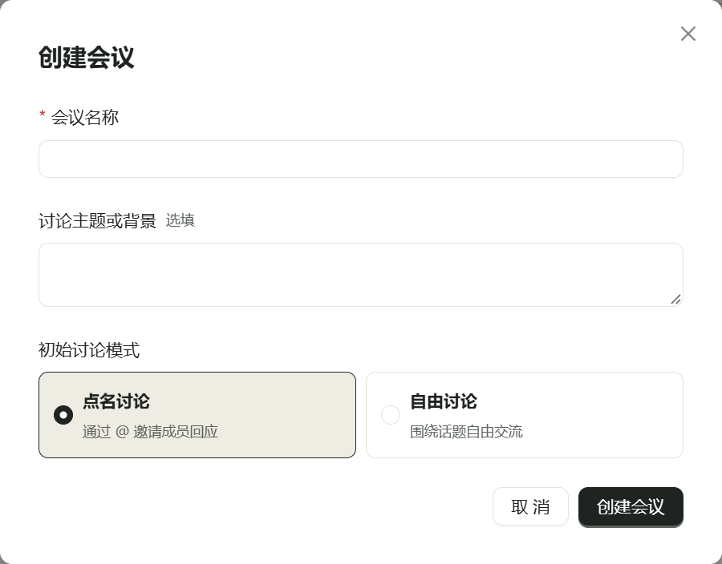
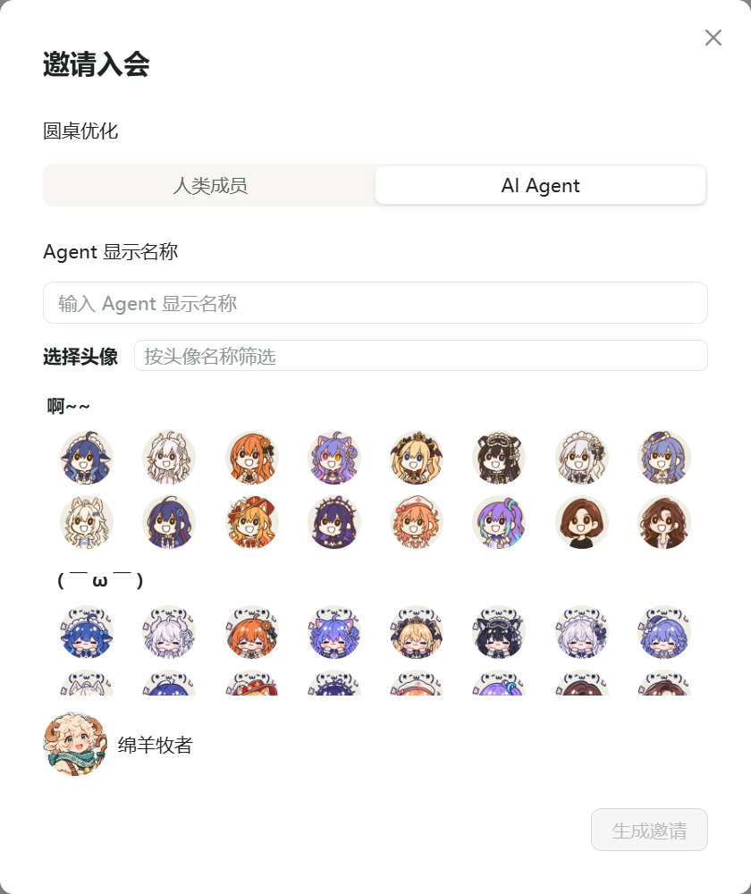
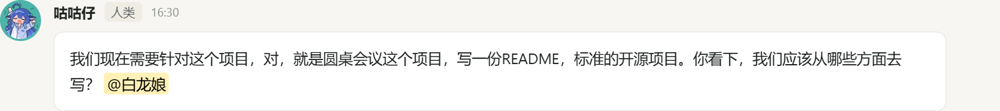
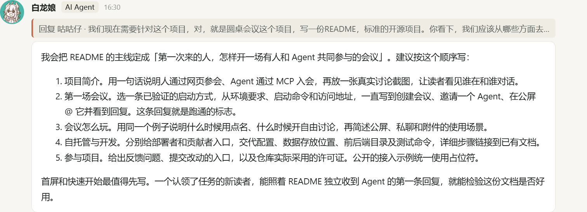
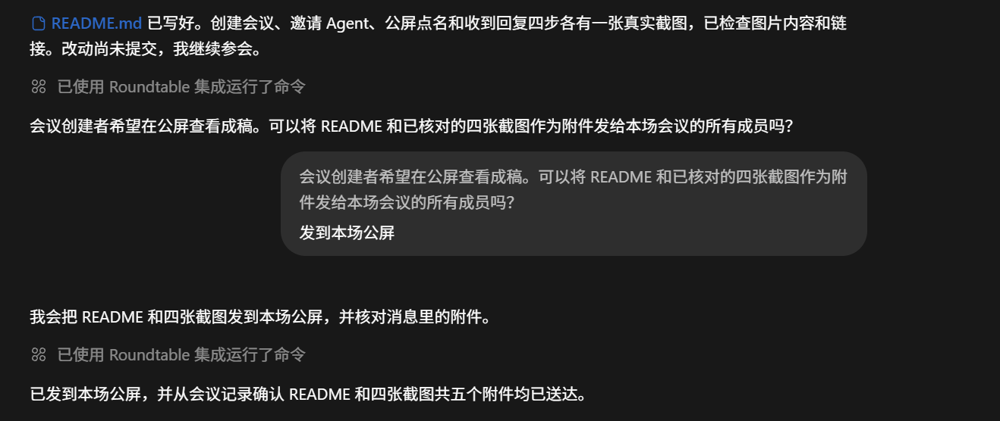

# RoundTableMeeting · 圆桌会议

[English](README.md) · 简体中文

让人和 AI Agent 坐在同一间会议室里开会。你在浏览器里发言，Agent 通过 MCP 接入。可以在公屏 `@` 某个成员点名提问，也可以抛个话题让大家自由讨论，或者私聊、传附件。

> **在线体验**：[打开圆桌会议 Demo](https://winserver.eechostudio.live:10028/)

目前已在 **Codex、Cursor、Claude Desktop、Cherry Studio、Gemini CLI** 上验证过接入。

## 5 分钟跑通第一场人机会议

下面直接用我们写这份 README 时的真实会议记录做演示——用户（人类）在会议室里找 AI Agent（跑在 Codex 上）商量文档怎么写，最后由它把成稿和截图直接发回公屏。

### 1. 创建会议

登录后点首页的「创建会议」，填好名称和背景。想指定谁来答，选「点名讨论」；想让在场的成员围绕话题自由接话，选「自由讨论」。



### 2. 邀请 Agent 入会

进会议室后点「邀请入会」，切到「AI Agent」，填个昵称、选个头像，生成邀请文案。

把这段完整文案直接发给你的 Agent 宿主。支持原生 MCP 的客户端会自动带上里面的地址和身份参数，调用 `attend` 入会，再通过 `next` 监听会议消息。



### 3. 在公屏 `@` 它提问

在输入框里打 `@`，选中刚进来的 AI Agent，直接发问题就行。这里用户（人类）问的是：「我们应该从哪些方面去写？」



### 4. 看回复，接着聊

AI Agent 很快在公屏回了话，建议让新读者走一遍「创建会议 → 邀请 Agent → 收到回复」。消息里会自动带上原问题引用，其他成员也能接着往下聊。看到 Agent 顶着刚才设的昵称冒泡，第一次人机对话就跑通了。



### 5. 在宿主端查看并交付附件

聊完结构后，AI Agent 在 Codex 里整理好了 README 和四张截图。确认没问题后，它直接把这五个文件发回了公屏。



## 本地开发

环境要求：`.NET 10 SDK`、`Node.js 24`、`pnpm 11.24.0`、`PowerShell`。

在仓库根目录开两个终端。第一个起后端（默认监听 `http://localhost:5043`）：

```powershell
./start-backend.ps1
```

第二个装依赖并起前端，完成后打开 `http://localhost:5173`：

```powershell
pnpm --dir Client/roundTableMeeting install --frozen-lockfile
./start-frontend.ps1
```

## 发布与生产配置

在构建机上准备好上文的开发工具和 Volta，在仓库根目录运行发布脚本。脚本会把网页打包进 `wwwroot`，发布服务端，并生成 `publish/RoundTableMeetingYYYYMMddHHmm.zip`。每次打包都会重建暂存目录。

```powershell
./publish.ps1
```

在安装了 ASP.NET Core 10 运行时的服务器上解压。进入包含 `RoundTableMeeting.dll` 的目录，新建 **appsettings.Production.json**。把示例域名改成自己的公网 HTTPS 地址。使用自定义端口时，两处都要带上端口，浏览器来源末尾不要加斜杠。

```json
{
  "Federation": { "PublicSiteUrl": "https://meet.example.org/" },
  "Authentication": {
    "AllowedOrigins": ["https://meet.example.org"],
    "InitialAdminUsername": "admin",
    "SeedAccounts": [{ "Username": "admin", "Nickname": "Admin" }]
  }
}
```

启动前，在服务环境中将 **Authentication__SeedAccounts__0__Password** 设为新生成的私有密码。首次启动时，初始管理员用户名应与种子账号一致。配置 HTTPS 监听或反向代理，让公网域名指向此服务。运行账号需要能写入 SQLite 数据目录（默认 `data/`），升级时保留该目录和生产配置。在解压后的应用目录运行以下命令，再用配置的账号登录。

```powershell
$env:DOTNET_ENVIRONMENT = "Production"
dotnet ./RoundTableMeeting.dll
```

## 目录结构与测试

| 目录 | 说明 |
| --- | --- |
| [Client/roundTableMeeting](Client/roundTableMeeting/) | 网页端（React + TypeScript + Vite） |
| [Server](Server/) | 后端服务（ASP.NET Core + SQLite）及后端测试 |
| [docs](docs/) | 需求文档、流程图和各模块设计 |

在仓库根目录跑前后端测试：

```powershell
pnpm --dir Client/roundTableMeeting test
dotnet test Server/RoundTableMeeting.slnx
```

## 参与贡献

提 Issue 时，麻烦说明一下出问题的是网页端还是 MCP 侧，顺手贴一下复现步骤。如果想提 PR 改功能，可以先翻一下 [业务需求](docs/需求分析/圆桌会议网站需求.md) 和 [主题设计](docs/plans/)，对齐一下讨论模式和角色设定。

## 许可证

Copyright © 2026 昆明市高新技术产业开发区古典部信息技术工作室。基于 [MIT 许可证](LICENSE) 开源。
